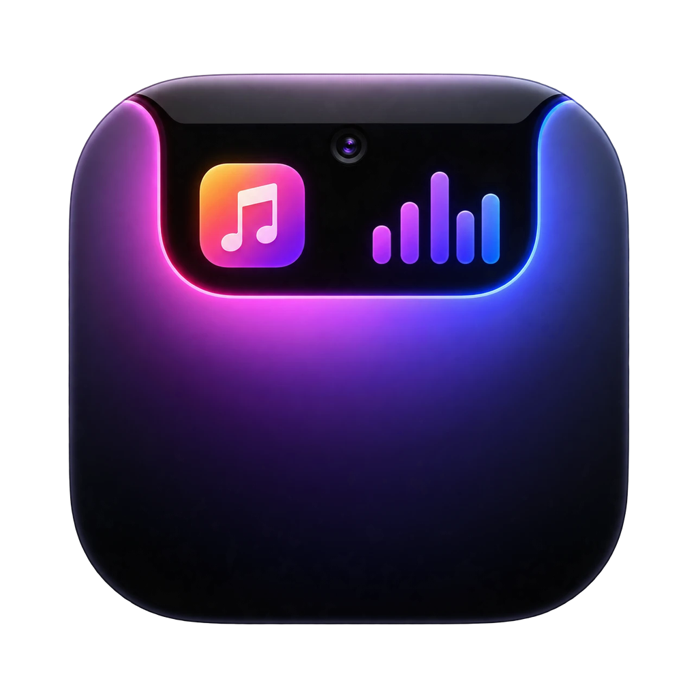
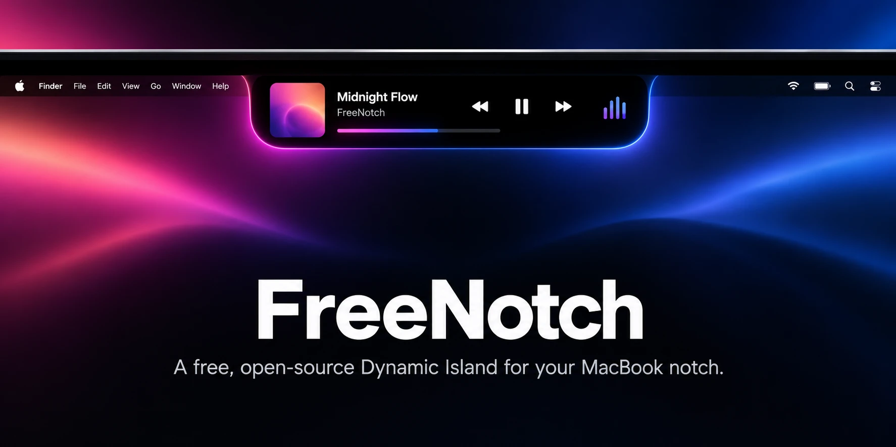
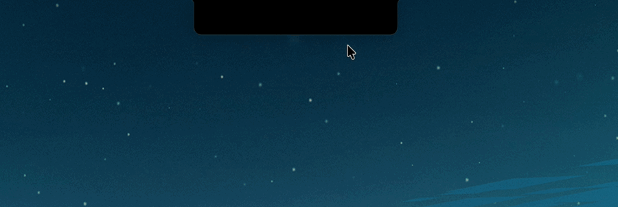
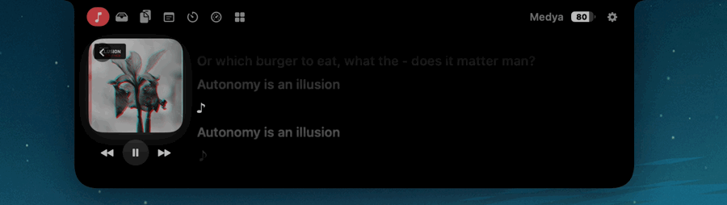
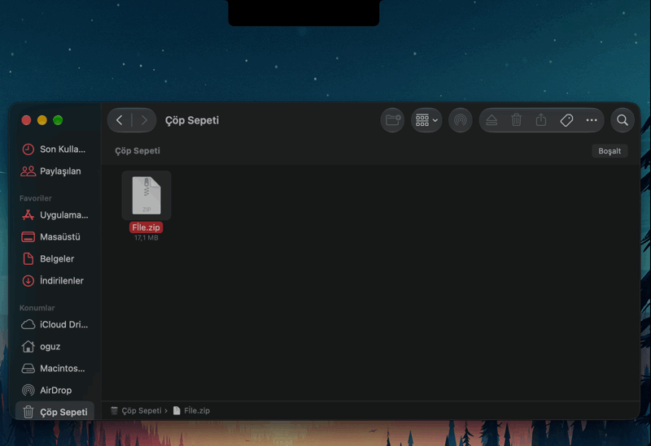
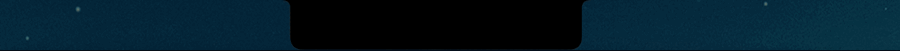
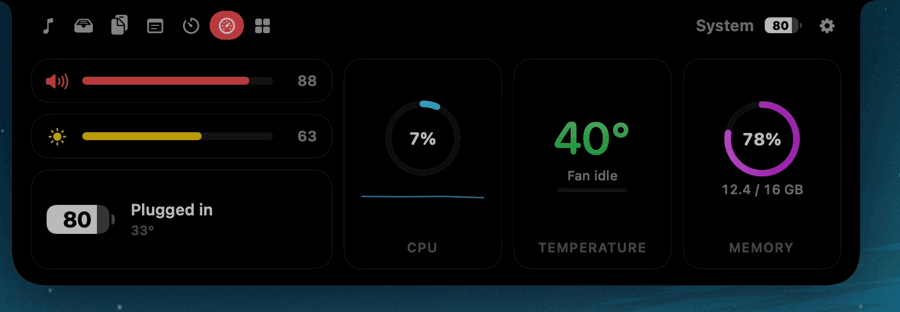

<p align="center">
  
</p>

<h1 align="center">FreeNotch</h1>

<p align="center">
  <strong>A free, open-source Dynamic Island for the MacBook notch.</strong><br>
  Music, lyrics, a file shelf, clipboard history, notes, timers and a better volume HUD, all living in the notch.
</p>

<p align="center">
  <a href="https://github.com/werquess/FreeNotch/releases/latest/download/FreeNotch.dmg"></a>
  <a href="https://buymeacoffee.com/werquess"></a>
</p>

<p align="center">
  
  
  
  
</p>

<p align="center">
  
</p>

---

## Why FreeNotch?

<p align="center"></p>

The notch is the most underused part of your screen. FreeNotch turns it into a small, smooth, Dynamic Island-style hub, without a subscription, without an account, and without draining your battery.

- **Free and open source.** MIT licensed. No ads, no tracking, no accounts.
- **Built for battery life.** FreeNotch reacts to system events instead of polling. When the notch is closed and nothing is playing, it uses effectively zero CPU.
- **Native and fast.** Written in Swift with SwiftUI and AppKit. No Electron, no web views in the background.
- **Feels like it belongs.** Spring animations, a shape that matches the hardware notch, and themes from pure OLED black to Liquid Glass.

## Features

### 🎵 Media
- Now playing from **Spotify**, **Apple Music** and your **browser** (YouTube and other sites in Safari, Chrome, Brave, Edge and Arc).
- Album art, title, artist, a scrubbable progress bar and playback controls.
- When several things are playing, each source gets its own tab.
- A live equalizer and artwork in the closed notch, plus a short preview when the song changes.
- **Synced lyrics** that scroll with the song. Click a line to jump to it. Optionally show the current line under the closed notch.

<p align="center"></p>

### 📥 Shelf and AirDrop
- Start dragging a file anywhere and a **drop zone** slides out of the notch.
- Drop files on the shelf to keep them handy, then drag them out wherever you need them.
- Drop on **AirDrop** to send instantly.
- Drag one file out and the whole shelf gathers under the pointer as a pile. Hold ⌘ to take just one.
- Previews follow the file: image and PDF thumbnails, and folders in their real Finder color.

<p align="center"></p>

### 📋 Clipboard history
- Text, images and files you copy, searchable and one click away.
- Content that password managers mark as concealed is never stored.

### 📝 Notes
- Notes stored in a local SQLite database.
- **Password-lock** individual notes. Locked notes are encrypted with AES-GCM using a PBKDF2-derived key, and your password is never stored.
- The notch grows taller on the Notes tab so you have room to write.

### ⏱ Focus
- **Pomodoro** timer with a live countdown in the closed notch.
- **Stopwatch** with laps.
- Upcoming **calendar** events.

### 🖥 System and HUD
- Volume and brightness HUD in the notch. FreeNotch can **replace the macOS overlay** entirely.
- CPU, memory, **temperature in °C** and **fan speed in RPM**.
- A macOS-style battery indicator, charging and AirPods connection alerts.

<p align="center"></p>
<p align="center"></p>

### 🧰 Tools
- **Mirror**: a quick camera preview, only running while visible.
- **Keep Awake**: stops your Mac from sleeping until you turn it off, with a small menu bar indicator.
- **Color Picker**: pick any color on screen and copy its HEX value.

### 🎨 Make it yours
- **Themes:** OLED Black, Graphite, Liquid Glass (macOS 26+) and Frosted.
- **Accent color:** follow the macOS accent color or pick your own.
- Reorder or hide tabs from Settings, or drag them right in the notch.
- Adjustable size, animation speed and per-feature toggles for every live activity.
- **Languages:** English, Türkçe, Deutsch, Español, Français.

### 🔄 Updates built in
FreeNotch checks for new versions once a day and installs them in place. No need to come back to GitHub.

## Installation

1. **[Download FreeNotch.dmg](https://github.com/werquess/FreeNotch/releases/latest/download/FreeNotch.dmg)**
2. Open the disk image and drag **FreeNotch** into **Applications**.
3. Open FreeNotch. It lives in your notch and in the menu bar, with no Dock icon.

> [!NOTE]
> FreeNotch is not notarized by Apple yet. On first launch macOS may say it can't verify the developer.
> Right-click FreeNotch in Applications and choose **Open**, or go to **System Settings › Privacy & Security** and click **Open Anyway**. You only need to do this once.

### Requirements
- macOS 14 Sonoma or later
- A Mac with Apple Silicon. FreeNotch is designed for MacBooks with a notch and also works on other displays.

### Permissions

FreeNotch only asks for a permission when you use the feature that needs it.

| Permission | Used for |
| --- | --- |
| Automation | Reading and controlling Spotify, Music and browser playback |
| Accessibility | Replacing the macOS volume and brightness overlay (optional) |
| Input Monitoring | Showing the brightness HUD (optional) |
| Calendars | Showing upcoming events |
| Camera | The Mirror tool |
| Bluetooth | AirPods and headphone alerts |

**Browser media:** browsers don't announce what they're playing, so enable **View › Developer › Allow JavaScript from Apple Events** once in Chrome, Brave, Edge or Arc. In Safari, turn on **Settings › Advanced › Show features for web developers**, then **Develop › Allow JavaScript from Apple Events**.

## Privacy

FreeNotch has no analytics and no telemetry. It only connects to the internet to:
- fetch lyrics from [LRCLIB](https://lrclib.net),
- download album artwork for the song that is playing,
- check GitHub for new versions (can be turned off in Settings).

Notes, clipboard history and settings never leave your Mac.

## Roadmap

Planned for upcoming versions:

- [ ] **Mini Browser**: a small browser that lives in the notch.
- [ ] **Local and API AI support**: ask about what's on your screen and get answers, using a local model or your own API key.
- [ ] **AI usage limits**: see the usage limits of the AI apps you use, at a glance.

Have an idea? [Open an issue](https://github.com/werquess/FreeNotch/issues).

## Building from source

```bash
git clone https://github.com/werquess/FreeNotch.git
cd FreeNotch
./scripts/build_app.sh --run
```

This builds a release `build/FreeNotch.app` and launches it. You need Xcode 16 or later (or the matching Command Line Tools).

For development, `swift build` produces a debug binary. `.build/debug/FreeNotch --snapshot snaps` renders every notch state to PNG files, which is handy for checking layouts.

### Publishing a release

```bash
./scripts/release.sh 1.1.0
gh release create v1.1.0 dist/FreeNotch.dmg dist/FreeNotch.zip --title "FreeNotch 1.1.0" --notes-file CHANGELOG.md
```

`FreeNotch.dmg` is what people download, and `FreeNotch.zip` is what the built-in updater installs. Both need to be attached to every release.

## Support FreeNotch

FreeNotch is free and always will be. If it makes your Mac a little nicer, you can support its development:

<a href="https://buymeacoffee.com/werquess"></a>

Starring the repo and telling a friend helps a lot too. ⭐

## Contributing

Bug reports, translations and pull requests are welcome. See [CONTRIBUTING.md](CONTRIBUTING.md).

## License

FreeNotch is released under the [MIT License](LICENSE).
